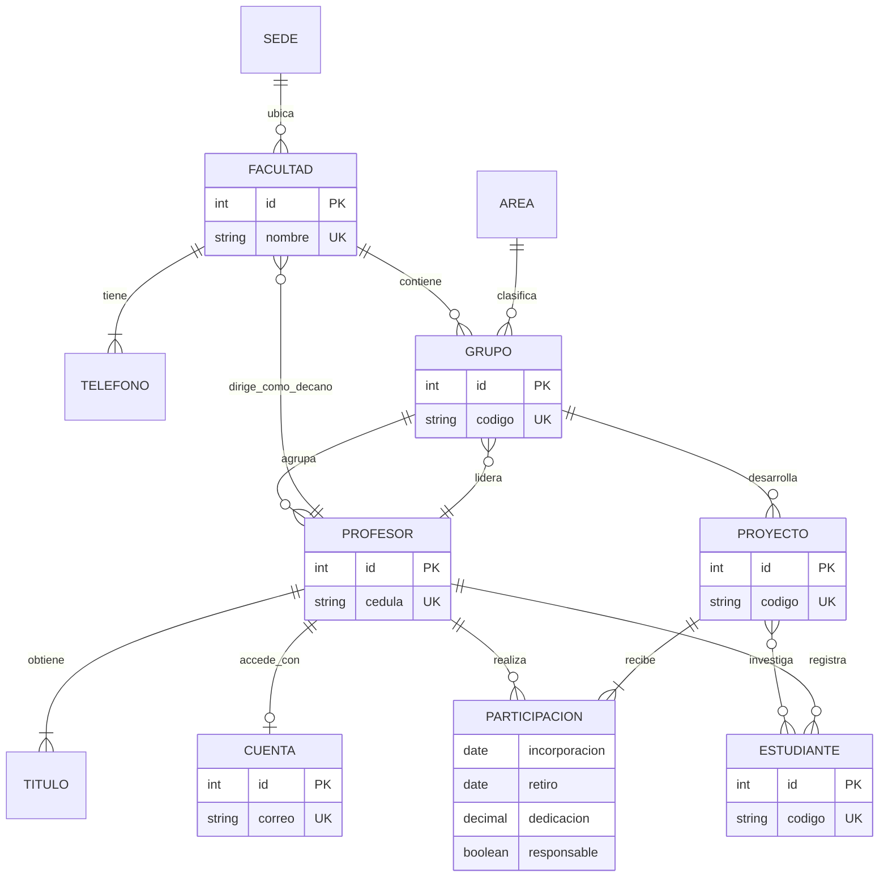
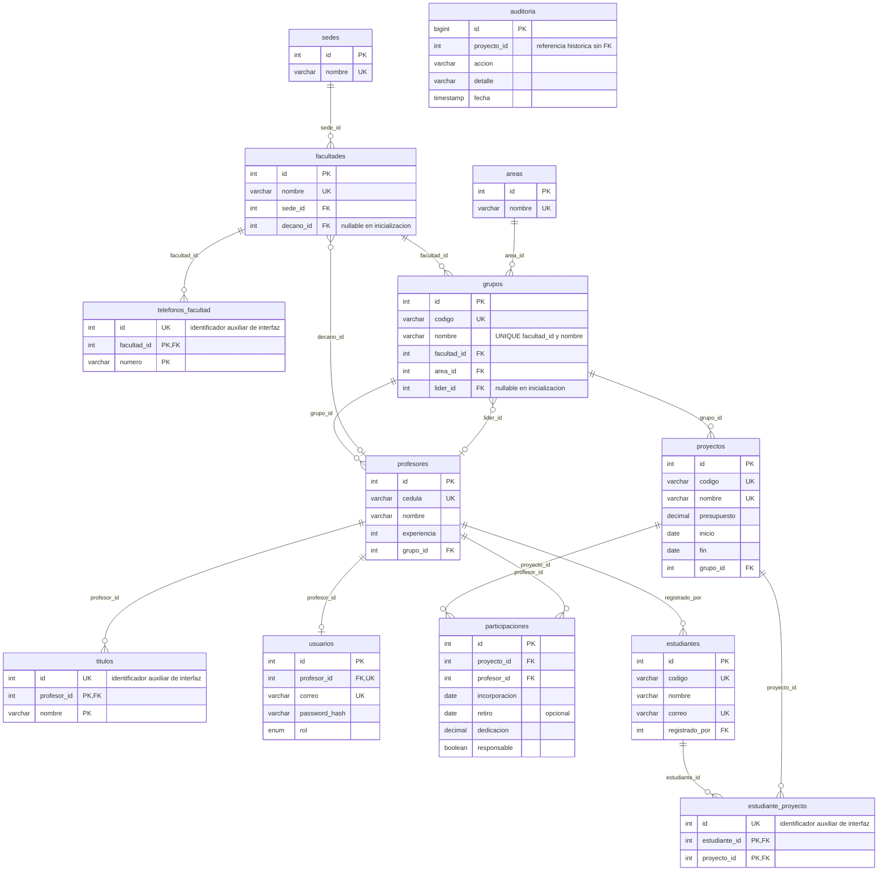

# Modelos de datos

Modelos revisados el 19 de noviembre de 2026 según la devolución del primer avance. Los diagramas Mermaid son editables. El conceptual usa notación de pata de cuervo, sin flechas dirigidas ni rombos. El relacional detalla las claves y tablas de la implementación. La inicialización de referencias cíclicas se explica en entrega.md.

## Modelo entidad–relación conceptual

Las cardinalidades mínimas de teléfono, título y participación representan el dominio. Se cumplen mediante altas transaccionales, triggers y permisos que impiden a la cuenta web escribir directamente en las tablas. Los responsables son un subconjunto de las participaciones de profesores. La auditoría es un objeto técnico, fuera del modelo conceptual. Un estudiante puede registrarse antes de vincularse: la relación con proyectos es 0..N a 0..N. No se modela vigente como atributo persistente.

Las FK de proyecto en participaciones y estudiante_proyecto usan ON DELETE CASCADE; se conservan las identidades estudiantiles. La nulabilidad física transitoria de decano_id/lider_id permite crear las referencias circulares en una sola transacción administrativa; los estados intermedios no forman parte de las altas operativas confirmadas. Ver objetos-bd.md.

Teléfono y título son atributos multivaluados del dominio. Aquí se expanden para facilitar lectura; su transformación al modelo relacional utiliza la clave del propietario y el valor del atributo como PK compuesta.

## Modelo relacional implementado

## Normalización y diferencias con el avance

Las sedes y áreas se separan como catálogos. Los teléfonos de facultad y títulos de profesor se mantienen separados para evitar listas en una columna. Sus PK son (facultad_id, numero) y (profesor_id, nombre); id es solamente una clave alternativa UNIQUE para la interfaz. Así se impiden valores repetidos para un propietario y se permiten valores iguales para propietarios diferentes.

La relación profesor–proyecto conserva su tabla asociativa y permite reingresos no simultáneos. La relación estudiante–proyecto se transforma en estudiante_proyecto, con PK (estudiante_id, proyecto_id). El estudiante se registra una sola vez y no contiene una FK exclusiva a un proyecto.

Se evita almacenar estado de proyecto y vigencia de participación, que dependen de la fecha. Las relaciones facultad–grupo, grupo–profesor y grupo–proyecto se resuelven con FK en el lado muchos. El vínculo profesor–cuenta utiliza FK UNIQUE. El avance representa estos vínculos mediante tablas adicionales, que no son necesarias con las cardinalidades establecidas.

La auditoría conserva un identificador histórico sin FK para permitir la eliminación del proyecto sin perder la bitácora. Las entidades principales usan identificadores técnicos id como PK en ambos modelos; cédulas y códigos se mantienen como claves alternativas UNIQUE. Esto es una revisión explícita de los identificadores del avance, no una mezcla de código como PK conceptual con id como PK física.

## Correspondencia de identificadores y referencias

| Entidad / tabla | PK en el modelo revisado y SQL | FK que la referencia |
|---|---|---|
| Proyecto / proyectos | id | participaciones.proyecto_id y estudiante_proyecto.proyecto_id → proyectos.id |
| Profesor / profesores | id | participaciones.profesor_id y titulos.profesor_id → profesores.id; también decano_id, lider_id, usuarios.profesor_id y estudiantes.registrado_por |
| Facultad / facultades | id | grupos.facultad_id y telefonos_facultad.facultad_id → facultades.id |
| Grupo / grupos | id | profesores.grupo_id y proyectos.grupo_id → grupos.id |
| Estudiante / estudiantes | id | estudiante_proyecto.estudiante_id → estudiantes.id |
| Teléfono multivaluado | (facultad_id, numero) | facultad_id → facultades.id |
| Título multivaluado | (profesor_id, nombre) | profesor_id → profesores.id |

Las FK usan INT, igual que las PK referenciadas. No se relaciona un código VARCHAR con un id INT. El código del proyecto sigue siendo único institucionalmente y se usa para presentación y búsqueda.
